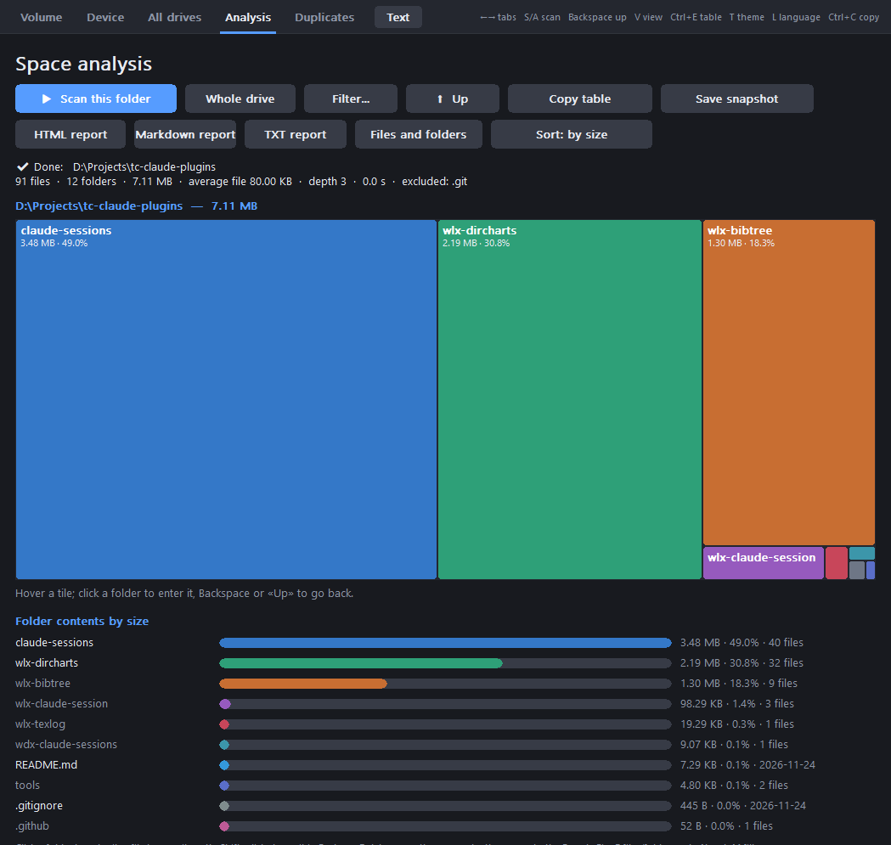
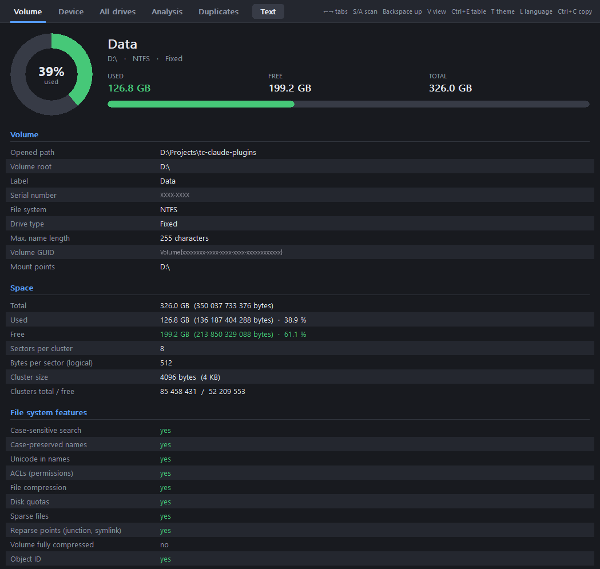
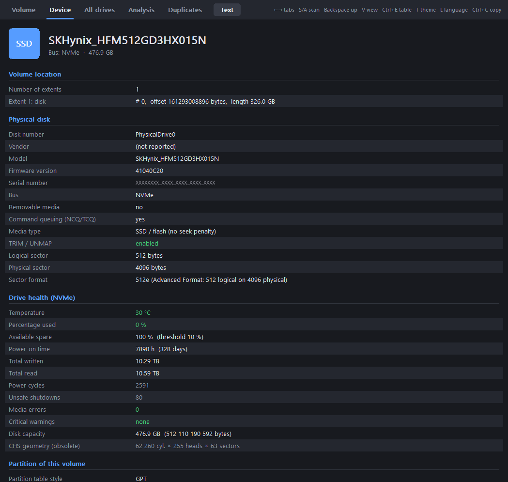
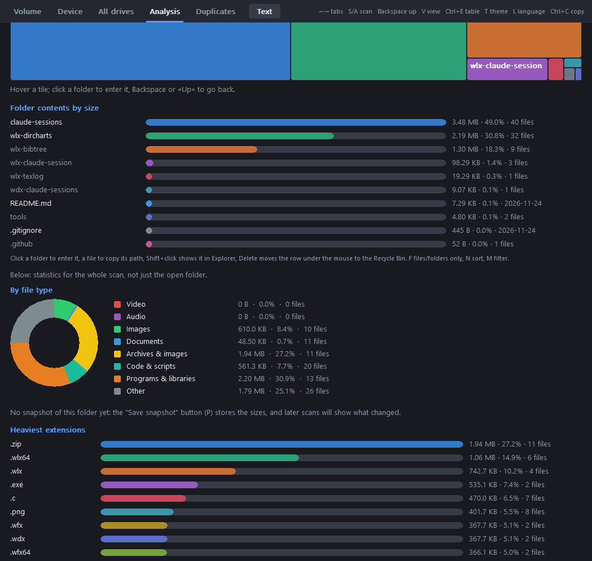
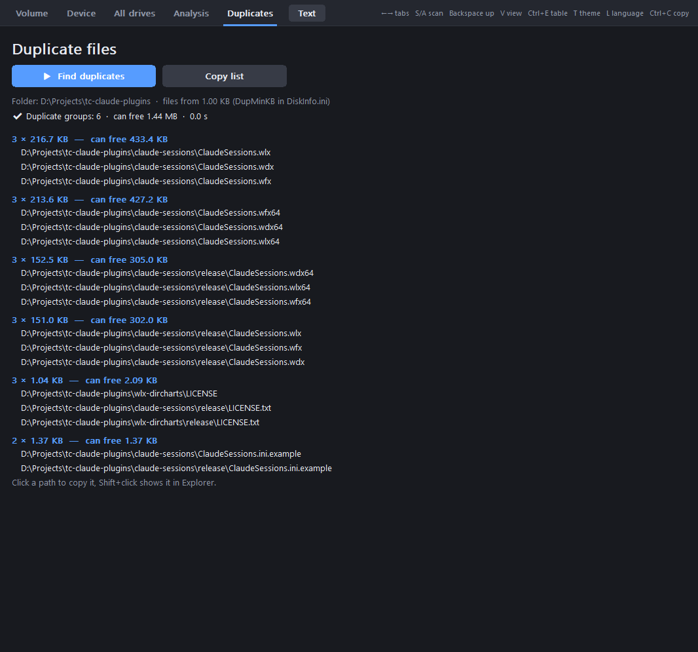
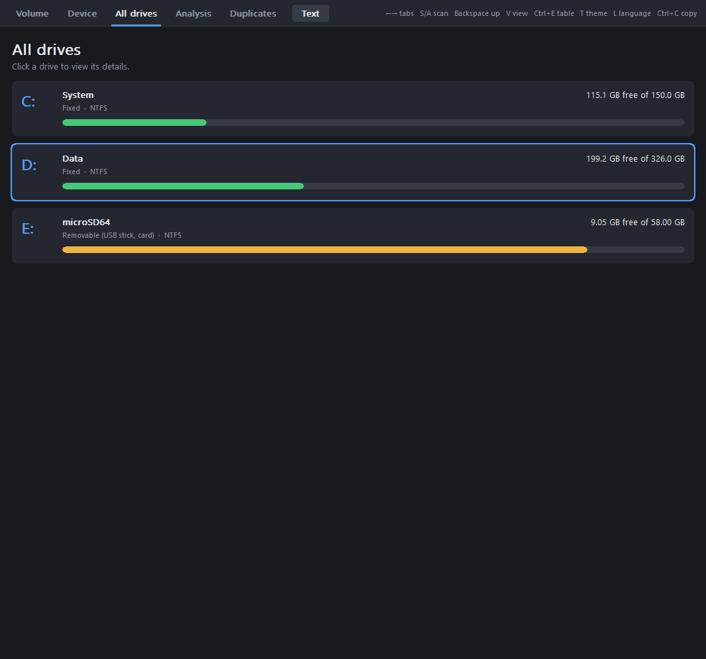

# DiskInfo 1.4.9

**English** · [Українська](README_UA.md)

Lister plugin for **Total Commander** (32 and 64 bit): detailed disk information plus a
DirSizeCalc-style space analyzer with an interactive treemap. Languages: English, Russian, Ukrainian.
Dark and light theme, graphic and text view. Only system DLLs are used. Freeware.

It is a replacement for the Lister plugins **DirSizeCalc Charts** and **VisualDirSize**: the same Ctrl+Q folder
analysis (see [what they had and where it is here](#replaces-dirsizecalc-charts-and-visualdirsize)), plus
disk/volume/device information, duplicates, snapshots and HTML/TXT reports. It does **not** replace the *DirSizeCalc*
content plugin (WDX) that adds folder-size columns to the file panel: that is a different kind of plugin.

**Download:** [Releases](https://github.com/sergiokapone/tc-diskinfo/releases) → `DiskInfo-1.4.9.zip`
(open it in Total Commander, press Enter, confirm — TC installs it).

## Tabs

| Tab | What it shows |
|---|---|
| **Volume** | label, serial, file system, GUID, mount points, cluster size, free space (quota aware), NTFS internals (`$MFT`), file system feature flags |
| **Device** | vendor, model, firmware, bus, SSD or HDD, TRIM, logical/physical sector (512n/512e/4Kn), write cache, GPT/MBR, partition alignment; **drive health**: temperature and the NVMe health log (wear, power-on hours, data written/read, unsafe shutdowns, media errors) |
| **All drives** | a card for every drive letter with a usage bar; click to inspect |
| **Analysis** | background scan of a folder or a whole drive: treemap (click a folder to drill down), folder list with sub-folders **and files** (sort by size, name, type or date, Delete to the Recycle Bin), file mask filter, file types, heaviest extensions, files by age and by size, 30 largest files, what changed since the last snapshot; notices when the folder changes |
| **Duplicates** | duplicate files in the folder, groups sorted by wasted space |

<table>
<tr>
<td></td>
<td></td>
</tr>
<tr>
<td></td>
<td></td>
</tr>
</table>

## Usage

- **Ctrl+Q** (Quick View) on a folder: the analysis starts automatically.
- **F3** on any file, then press `4` / pick the plugin: inspects that file's drive.

| Key | Action |
|---|---|
| `V` | graphic / text view (also the "View" item in the status bar) |
| `I` | show / hide the key hints and help lines (also the (i) icon at the top right) |
| `S` / `A` | scan the folder / the whole drive |
| `U` | find duplicates |
| `Z` | save a snapshot |
| `H` / `Shift+H` | HTML report / Markdown report (the TXT report is in the right-click menu) |
| `O` | sort the folder list: size / name / type / date (also the ▾ menu of the list heading or the sorting in the status bar) |
| `M` | file filter (masks) |
| `Delete` | move the list row under the mouse to the Recycle Bin |
| `D` | sizes as "size on disk" (rounded up to the cluster), rescans |
| `X` | stop the scan |
| `Backspace` | up one folder |
| right click | **context menu** with everything above (the keys are shown in it); on a row of the folder list also: open, copy path, show in Explorer, delete |
| `Ctrl+E` / `Ctrl+C` | copy the table (TSV, for Excel) / copy the tab |
| `T` / `L` | theme / language |
| `F5` | refresh |
| `←` `→`, `Tab` | switch tabs |

Click on a path copies it; **Shift+click** shows the file in Explorer. In the folder list a click on a folder enters it.

## Install

1. Open `DiskInfo-1.4.9.zip` in Total Commander (Enter) and confirm, **or** Configuration → Options →
   Plugins → Lister plugins (WLX) → Add, pick `DiskInfo.wlx64`.
2. To make it open on folders in Quick View, set its detect string to `EXT=""` and keep it above other
   plugins that also use `EXT=""` (e.g. VisualDirSize). The plugin refuses plain files unless you force it
   (F3, then key `4`), so other plugins still get them.

## Settings

`DiskInfo.ini` next to the plugin (see `DiskInfo.ini.example`); it is read on every open.
Keys `L`, `V`, `T`, `D`, `I`, the sort menu and the view switch save their choice there.

| Key | Values |
|---|---|
| `Language` | `auto` (Windows UI language, other → English), `uk`, `ru`, `en` |
| `View` | `graphic`, `text` |
| `Theme` | `auto` (default: follows Total Commander), `dark`, `light` |
| `SizeOnDisk` | `0` logical sizes, `1` size on disk |
| `Exclude` | folder names the scan skips, e.g. `.git;node_modules` |
| `DupMinKB` | duplicate search ignores smaller files (default 1024) |
| `Sort` | `size`, `name`, `type` or `date` |
| `Hints` | `1` (default) key hints and help lines shown, `0` folded into the (i) icon |
| `Filter` | file masks, e.g. `*.jpg;*.png`; only these files are counted |
| `FilterExclude` | `1`: count everything except the files matching `Filter` |
| `AutoUpdate` | `1`: rescan by itself a few seconds after the folder stops changing (default `0`: a banner and F5) |

## Features in detail

**Duplicates.** Files of equal size, then equal first 64 KB, then equal 64-bit hash of the whole file.
"Copy list" gives a TSV. Files are not compared byte by byte; symlinks and cloud-only files are skipped.

**Snapshots.** `Z` stores folder sizes in `DiskInfo-snapshots` next to the plugin; the next scan of that
folder shows what grew, shrank, appeared or vanished.

**Reports.** `H` writes `DiskInfo-reports\<name>.html` next to the plugin and opens it in the browser; `Shift+H` writes the same as Markdown (`.md`, tables; renders on GitHub and in any Markdown viewer), the "TXT report" button as plain text.

**Filter.** `M` (the status bar at the bottom of the Analysis tab shows the active filter and a click on it opens the dialog) takes masks with `*` and `?` separated by `;`. Only the matching files are counted, or with the checkbox everything except them. There are no regular expressions.

**Change watch.** After a scan the folder is watched. When something changes a banner and a Refresh button appear (`F5`); the rescan comes back to the sub-folder you had open. `AutoUpdate=1` does it by itself.

**Delete.** Put the mouse on a row of the folder list and press `Delete`: after a confirmation the folder or file goes to the Recycle Bin and the scan is refreshed.

**Text view.** `V` (or `View=text`): the same tabs as monospace console-style text with block progress bars;
click a folder row to drill down.

## Replaces DirSizeCalc Charts and VisualDirSize

| They had | Here |
|---|---|
| DirSizeCalc Charts: all files and folders by size with bars, entering sub-folders, Backspace up, Delete to the Recycle Bin, empty-folder marks | the folder list with files and folders, click / Backspace, `Delete` to the Recycle Bin, "empty" / "no files" marks |
| VisualDirSize: bar, pie and block charts | treemap, bars and a donut by file type |
| VisualDirSize: sort by size or name; files and folders | `O` (size, name, type, date); files are always listed |
| VisualDirSize: scan filter by file mask (and "exclude matching") | `M` / `Filter=` / `FilterExclude=` (masks only, no regular expressions or TC searches) |
| VisualDirSize: automatic update on folder change | change watch: banner + Refresh, or `AutoUpdate=1` |
| VisualDirSize: report as HTML, TXT or image | HTML, Markdown and TXT (no image) |
| VisualDirSize: extension chart, total file count | "Heaviest extensions", file and folder counts |
| VisualDirSize: colour schemes, own font | dark / light theme only |
| DirSizeCalc (WDX): size / file-count columns in the file panel, search by "empty folder" | **not replaced**: a Lister plugin cannot add panel columns |

Not in the old plugins: volume and device information, NVMe health, duplicates, snapshots, size on disk, 32 and 64 bit builds, Ukrainian, Russian and English.

## Changes

### 1.4.9
- **+** Version information in the DLLs (Properties > Details: version, author, copyright, description), for plugin managers

### 1.4.8
- **+** The status bar is on every tab; the graphic / text switch moved there from the tab bar
- **+** Hints can be folded: the (i) icon at the top right or key `I` hides / shows the key line and the help lines; `Hints=` in the ini
- **~** The "Up" button sits next to the map, before the folder path, and is greyed at the top level instead of disappearing
- **~** List heading "Folder contents: sort by size ▾": a click opens the sort menu
- **-** Fixed: a click on the status bar went through to the list row scrolled under it

### 1.4.7
- **+** Text view: the folder list uses the same aligned columns as the tables below it (percent, size, files or date); the name column follows the window width in all tables

### 1.4.6
- **+** The scrollbar is drawn by the plugin: a thin rounded thumb in the theme colours (drag it, click the empty part to page; wheel and keys as before)
- **+** The right-click menu and the filter dialog use the theme colours too (they used to be fixed dark); the system frame around the menu is repainted
- **-** The "Settings: <path>" item is removed from the right-click menu

### 1.4.5
- **+** `Theme=auto` (new default): the plugin follows Total Commander and takes the colours of its colour scheme (background, text, second background; `[Colors]` or `[ColorsDark]`, also redirected to `View\colors*.ini`). Without a scheme colour it is dark or light by `DarkMode=` of `wincmd.ini`. `dark` and `light` still work, key `T` sets one of them

### 1.4.4
- **+** Folders in the list are shown in brackets, like in Total Commander: `[folder]`, files without
- **~** On the `[..]` row of the panel the analysis shows the open folder, not its parent
- **~** Any folder in the list can be opened (also those with no sub-folders: their files are shown)

### 1.4.3
- **+** The right-click menu ends with "Settings: <path>\DiskInfo.ini" - the ini file that is really used (the one next to the plugin DLL); a click shows it in Explorer

### 1.4.2
- **~** The status bar is flat like Total Commander's: scan statistics (files, folders, size) on the left, sorting on the right; the filter is shown there only while it is active
- **+** Sorting by type and by date (`O` or a click in the status bar): size → name → type → date
- **-** Removed the "files / folders only" switch (key `F`, `ShowFiles=`): files are always listed. Removed average file size, depth and scan time from the statistics

### 1.4.1
- **~** Keys: `N` and `P` are taken by Total Commander's Lister (next/previous file), so list sorting is now `O` and the snapshot is `Z`
- **~** Analysis tab: one row of buttons; Filter, files/folders and sorting moved to a status bar at the bottom; reports, snapshot and copy table are in the right-click menu
- **~** The checkbox of the dark filter dialog is drawn in the dark theme
- **~** The Up button is shown only when there is a level above the open folder

### 1.4
- **+** Replaces DirSizeCalc Charts and VisualDirSize (see the table above)
- **+** The folder list shows the files of the open folder; sorting by name or size (`O`), folders only (`F`), empty folders marked
- **+** `Delete` moves the row under the mouse to the Recycle Bin
- **+** File mask filter (`M`, `Filter=`, `FilterExclude=`)
- **+** Change watch with a Refresh button (`F5`), `AutoUpdate=1`; the open sub-folder stays open after a rescan
- **+** Markdown report (`Shift+H`) and TXT report (right-click menu), next to the HTML one
- **+** Right click opens a **context menu** with all actions and their keys (it used to go up; `Backspace` still does)
- **~** The context menu and the filter dialog follow the dark theme
- **~** Buttons wrap onto a second row in a narrow window

### 1.3
- **+** Duplicates tab (key `U`)
- **+** Snapshots: what changed since the last scan (key `Z`)
- **+** HTML report (key `H`)
- **+** Device tab: drive temperature and the NVMe health log
- **+** Key `D`: "size on disk"; `SizeOnDisk=1` in the ini
- **+** `Exclude=.git;node_modules` in the ini
- **+** Shift+click on a path shows the file in Explorer
- **~** Dark scrollbar in the dark theme

### 1.2
- **+** Volume tab: the drive name assigned in Total Commander (`[DriveHints]` in `wincmd.ini`) is shown in the header and in the "Label" row
- **+** Network drives: the shared folder name (as in `net use`) is shown as the drive name
- **+** Hand cursor over everything clickable
- **+** The row of "Largest files" under the mouse gets its path underlined

### 1.1.2
- **~** The Text/Graphics button saves the choice to `DiskInfo.ini`

### 1.1.1
- **+** `Theme=dark|light` in `DiskInfo.ini`
- **~** Keys `V`, `T`, `L` save View, Theme and Language to the ini

### 1.1
- **+** Text (console-style) view, key `V`

### 1.0
- **+** First release

## Notes

- Sizes are logical file sizes unless `SizeOnDisk=1`. Symlinks and junctions are not followed.
- Closed source; downloads, issues and questions: <https://github.com/sergiokapone/tc-diskinfo>.
