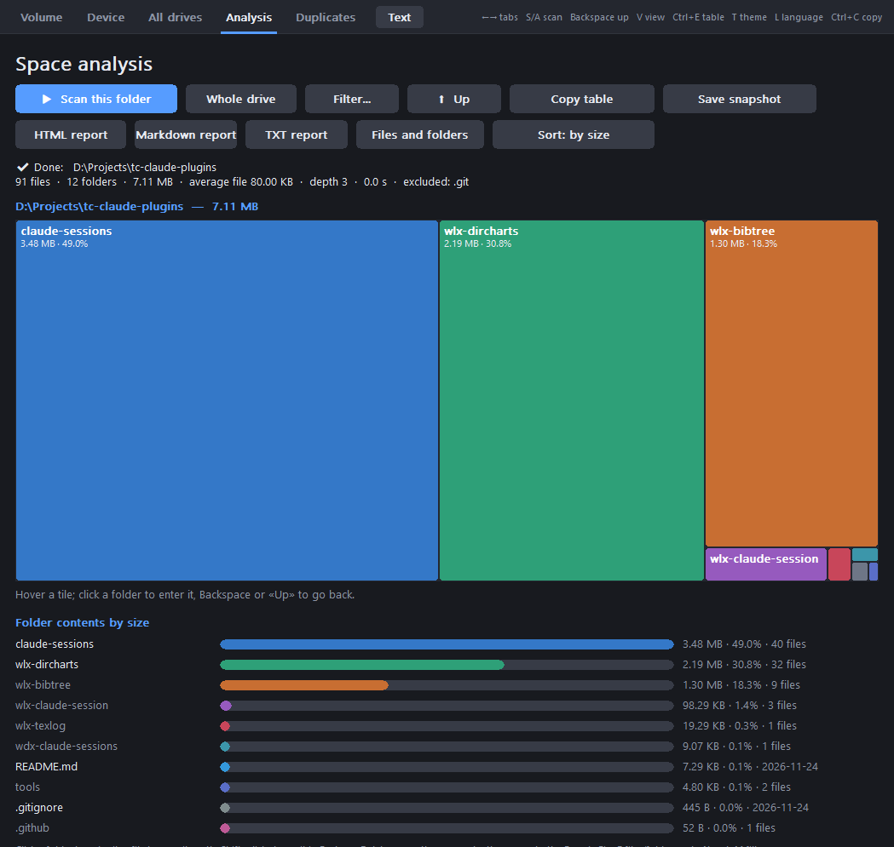
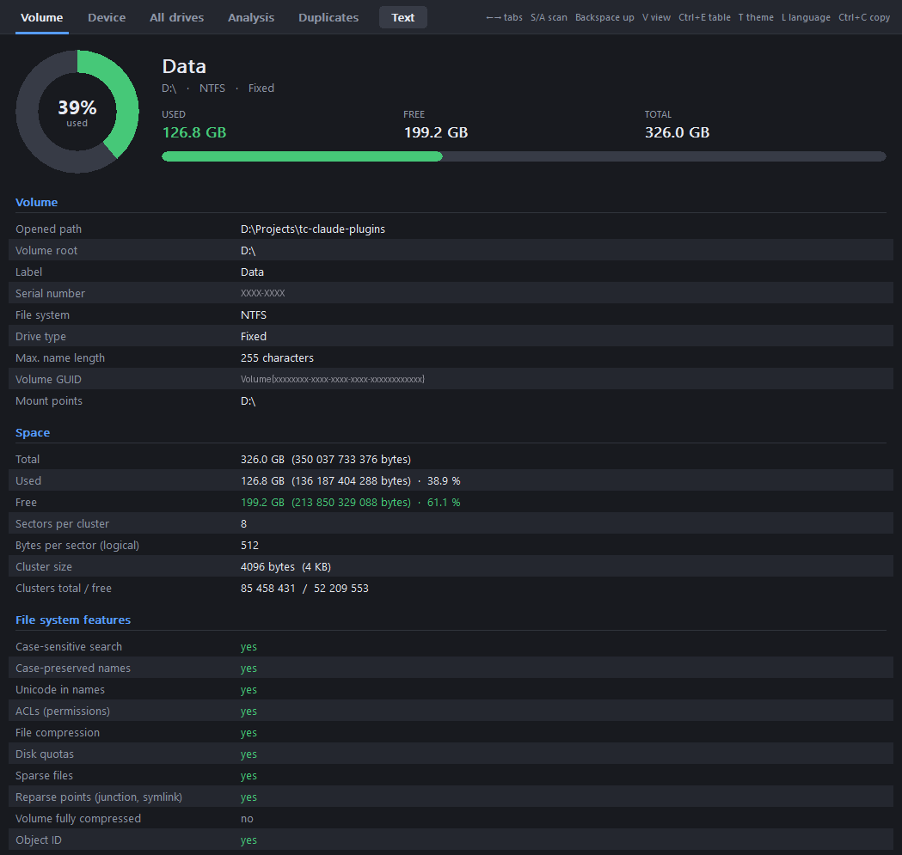
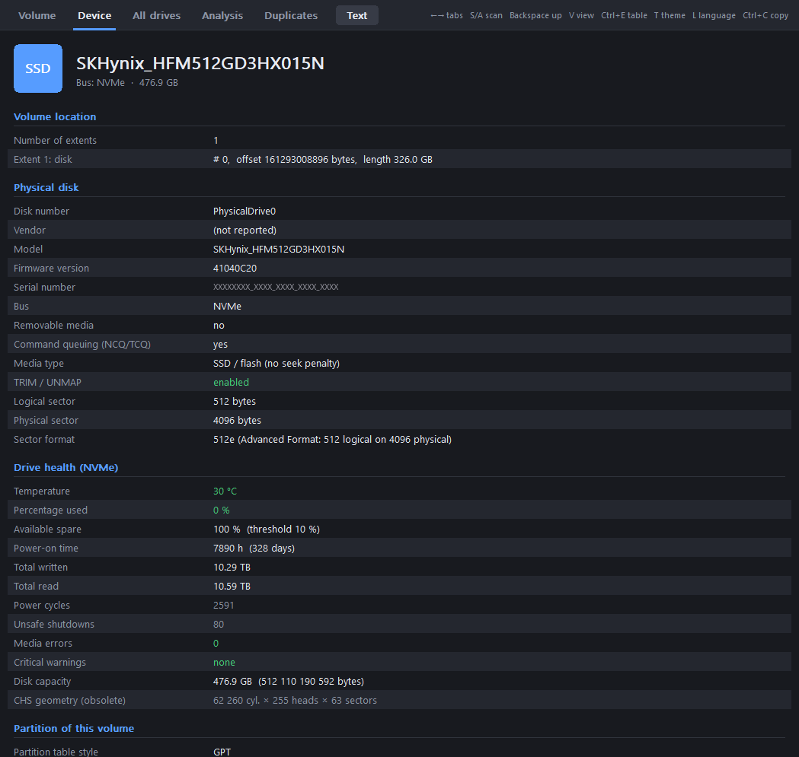
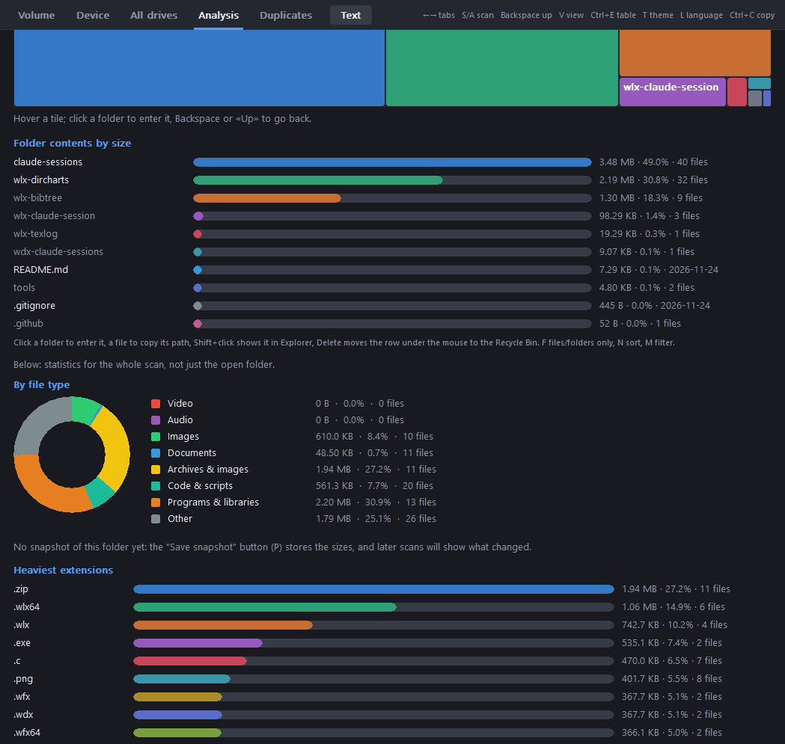
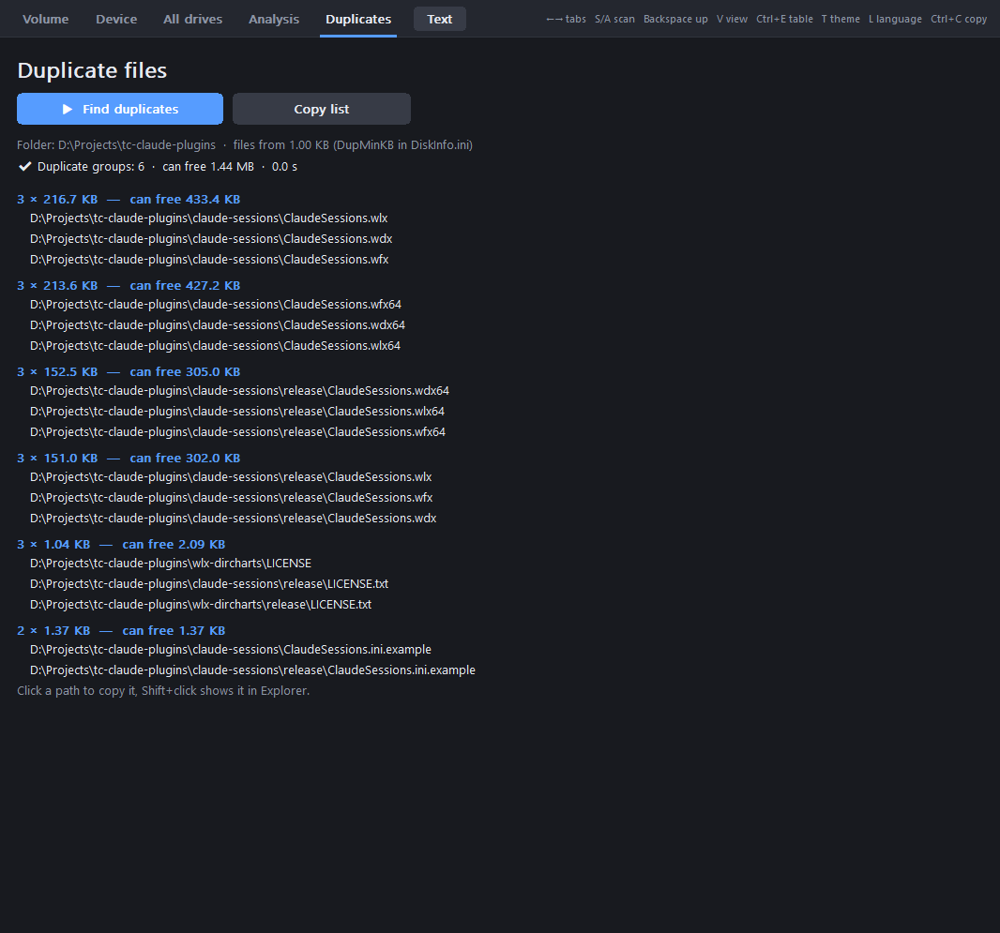
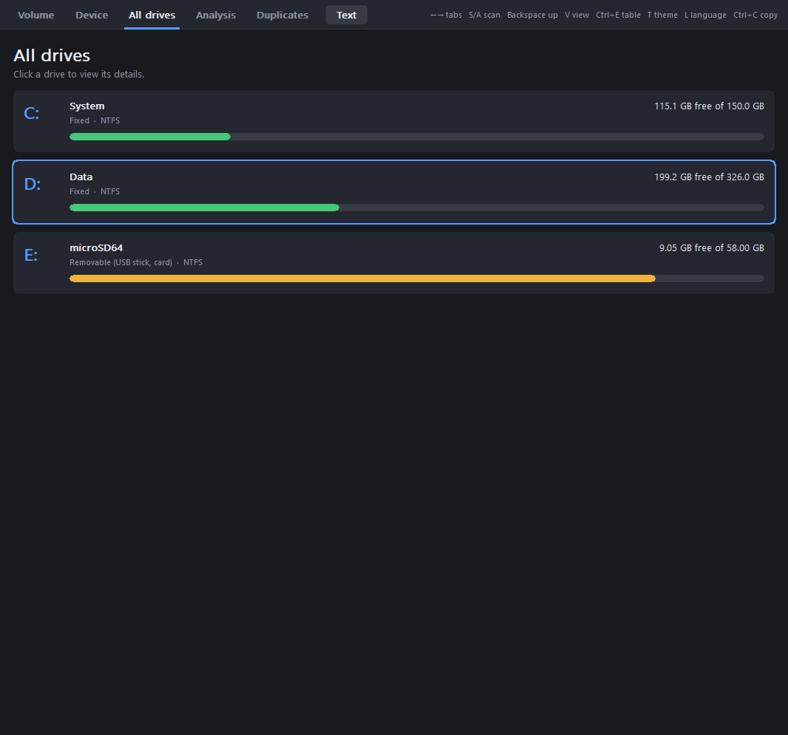

# DiskInfo 1.4.9

[English](README.md) · **Українська**

Lister-плагін для **Total Commander** (32 і 64 біт): докладна інформація про диск та аналізатор простору
в стилі DirSizeCalc з інтерактивним treemap. Мови інтерфейсу: англійська, російська, українська.
Темна й світла тема, графічний і текстовий вигляд. Використовує лише системні DLL. Безкоштовна (freeware).

Це заміна Lister-плагінів **DirSizeCalc Charts** і **VisualDirSize**: той самий аналіз теки по Ctrl+Q
(див. [що в них було й де це тут](#заміна-dirsizecalc-charts-і-visualdirsize)), а також інформація про
диск, том і пристрій, дублікати, знімки та звіти HTML/Markdown/TXT. Плагін **не** замінює контент-плагін
*DirSizeCalc* (WDX), який додає в панель файлів колонки з розмірами тек: це інший вид плагінів.

**Завантаження:** [Releases](https://github.com/sergiokapone/tc-diskinfo/releases) → `DiskInfo-1.4.9.zip`
(відкрийте його в Total Commander, натисніть Enter і підтвердіть: TC встановить плагін).

*Скріншоти зроблені з англійським інтерфейсом; мову можна змінити клавішею `L`.*

## Вкладки

| Вкладка | Що показує |
|---|---|
| **Том** | мітка, серійний номер, файлова система, GUID, точки монтування, розмір кластера, вільне місце (з квотами), службові дані NTFS (`$MFT`), прапорці можливостей файлової системи |
| **Пристрій** | виробник, модель, прошивка, шина, SSD чи HDD, TRIM, логічний/фізичний сектор (512n/512e/4Kn), кеш запису, GPT/MBR, вирівнювання розділу; **стан диска**: температура та журнал здоров'я NVMe (знос, напрацювання, записано/прочитано, небезпечні вимкнення, помилки носія) |
| **Усі диски** | картка кожної літери диска зі шкалою зайнятості; клік показує цей диск докладно |
| **Аналіз** | фонове сканування теки або всього диска: treemap (клік по теці занурює), список вмісту з підтеками **і файлами** (сортування за розміром, назвою, типом або датою, Delete у кошик), фільтр за маскою файлів, типи файлів, найважчі розширення, файли за віком і розміром, 30 найбільших файлів, що змінилось від останнього знімка; помічає, коли тека змінилась |
| **Дублікати** | дублікати файлів у теці, групи впорядковані за втраченим місцем |

<table>
<tr>
<td></td>
<td></td>
</tr>
<tr>
<td></td>
<td></td>
</tr>
</table>

## Використання

- **Ctrl+Q** (швидкий перегляд) на теці: аналіз запускається сам.
- **F3** на будь-якому файлі, потім клавіша `4` / вибір плагіна: показує диск цього файлу.

| Клавіша | Дія |
|---|---|
| `V` | графічний / текстовий вигляд (також пункт «Вигляд» у статусному рядку) |
| `I` | показати / сховати підказки клавіш і довідкові рядки (також значок (i) вгорі праворуч) |
| `S` / `A` | сканувати теку / весь диск |
| `U` | знайти дублікати |
| `Z` | зберегти знімок |
| `H` / `Shift+H` | звіт HTML / звіт Markdown (звіт TXT є в контекстному меню) |
| `O` | сортування списку: розмір / назва / тип / дата (також меню ▾ заголовка списку або сортування в рядку стану) |
| `M` | фільтр файлів (маски) |
| `Delete` | перенести рядок списку під курсором у кошик |
| `D` | розміри «на диску» (з округленням до кластера), перескановує |
| `X` | зупинити сканування |
| `Backspace` | на рівень вгору |
| права кнопка | **контекстне меню** з усім переліченим (у ньому видно клавіші); на рядку списку теки ще: відкрити, копіювати шлях, показати у Провіднику, видалити |
| `Ctrl+E` / `Ctrl+C` | копіювати таблицю (TSV, для Excel) / копіювати вкладку |
| `T` / `L` | тема / мова |
| `F5` | оновити |
| `←` `→`, `Tab` | перемикання вкладок |

Клік по шляху копіює його, **Shift+клік** показує файл у Провіднику. У списку теки клік по теці заходить у неї.

## Встановлення

1. Відкрийте `DiskInfo-1.4.9.zip` у Total Commander (Enter) і підтвердьте **або** Конфігурація → Параметри →
   Плагіни → Плагіни Lister (WLX) → Додати, оберіть `DiskInfo.wlx64`.
2. Щоб плагін відкривався на теках у швидкому перегляді, задайте йому рядок виявлення `EXT=""` і тримайте
   його вище за інші плагіни з `EXT=""` (наприклад VisualDirSize). Звичайні файли плагін відхиляє, якщо його не
   викликано вручну (F3, потім клавіша `4`), тож їх отримують інші плагіни.

## Налаштування

`DiskInfo.ini` поруч із плагіном (див. `DiskInfo.ini.example`); читається при кожному відкритті.
Клавіші `L`, `V`, `T`, `D`, `I`, меню сортування й перемикач вигляду зберігають свій вибір туди.

| Ключ | Значення |
|---|---|
| `Language` | `auto` (мова Windows, інша → англійська), `uk`, `ru`, `en` |
| `View` | `graphic`, `text` |
| `Theme` | `auto` (default: follows Total Commander), `dark`, `light` |
| `SizeOnDisk` | `0` логічні розміри, `1` розмір на диску |
| `Exclude` | назви тек, які сканування пропускає, наприклад `.git;node_modules` |
| `DupMinKB` | пошук дублікатів ігнорує менші файли (за замовчуванням 1024) |
| `Sort` | `size`, `name`, `type` або `date` |
| `Filter` | маски файлів, наприклад `*.jpg;*.png`; рахуються лише вони |
| `FilterExclude` | `1`: рахувати все, крім файлів, що збігаються з `Filter` |
| `AutoUpdate` | `1`: перескановувати самому за кілька секунд після того, як тека перестала змінюватись (за замовчуванням `0`: банер і F5) |

## Можливості докладніше

**Дублікати.** Файли однакового розміру, потім однаковий початок 64 КБ, потім однаковий 64-бітний хеш усього файлу.
«Копіювати список» дає TSV. Файли не порівнюються побайтово; символічні посилання та хмарні файли пропускаються.

**Знімки.** `Z` зберігає розміри тек у `DiskInfo-snapshots` поруч із плагіном; наступне сканування цієї теки
покаже, що зросло, зменшилось, з'явилось чи зникло.

**Звіти.** `H` записує `DiskInfo-reports\<назва>.html` поруч із плагіном і відкриває його в браузері; `Shift+H` записує те саме як Markdown (`.md`, таблиці; відображається на GitHub і в будь-якому переглядачі Markdown), кнопка «Звіт TXT» — як простий текст.

**Фільтр.** `M` (у рядку стану внизу вкладки «Аналіз» показується активний фільтр, клік по ньому відкриває діалог) приймає маски з `*` і `?` через `;`. Рахуються лише файли, що збігаються, а з галочкою — усе, крім них. Регулярних виразів немає.

**Стеження за текою.** Після сканування за текою стежать. Коли щось змінюється, з'являються банер і кнопка «Оновити» (`F5`); повторне сканування повертає в підтеку, яку ви відкрили. `AutoUpdate=1` робить це саме.

**Видалення.** Наведіть курсор на рядок списку теки й натисніть `Delete`: після підтвердження тека чи файл іде в кошик, і сканування оновлюється.

**Текстовий вигляд.** `V` (або `View=text`): ті самі вкладки моноширинним текстом у стилі консолі з блоковими індикаторами;
клік по рядку теки заходить у неї.

## Заміна DirSizeCalc Charts і VisualDirSize

| У них було | Тут |
|---|---|
| DirSizeCalc Charts: усі файли й теки за розміром зі смугами, вхід у підтеки, Backspace вгору, Delete у кошик, позначки порожніх тек | список теки з файлами й теками, клік / Backspace, `Delete` у кошик, позначки «порожня» / «без файлів» |
| VisualDirSize: смугова, кругова й блокова діаграми | treemap, смуги та кільце за типами файлів |
| VisualDirSize: сортування за розміром або назвою; файли й теки | `O` (розмір, назва, тип, дата); файли показуються завжди |
| VisualDirSize: фільтр сканування за маскою (і «виключити збіжні») | `M` / `Filter=` / `FilterExclude=` (лише маски, без регулярних виразів і пошуків TC) |
| VisualDirSize: автоматичне оновлення при зміні теки | стеження: банер + «Оновити», або `AutoUpdate=1` |
| VisualDirSize: звіт у HTML, TXT або як зображення | HTML, Markdown і TXT (зображення немає) |
| VisualDirSize: діаграма розширень, загальна кількість файлів | «Найважчі розширення», кількість файлів і тек |
| VisualDirSize: кольорові схеми, власний шрифт | лише темна / світла тема |
| DirSizeCalc (WDX): колонки розміру / кількості файлів у панелі, пошук за «порожня тека» | **не замінюється**: Lister-плагін не може додавати колонки в панель |

Чого не було в старих плагінах: інформація про том і пристрій, здоров'я NVMe, дублікати, знімки, розмір на диску, збірки 32 і 64 біт, українська, російська й англійська.

## Зміни

### 1.4.9
- **+** Інформація про версію в DLL (Властивості > Подробиці: версія, автор, копірайт, опис), для менеджерів плагінів

### 1.4.8
- **+** Статусний рядок на всіх вкладках; перемикач графіка / текст перенесено туди зі смуги вкладок
- **+** Підказки можна згорнути: значок (i) вгорі праворуч або клавіша `I` ховає / показує рядок клавіш і довідкові рядки; `Hints=` в ini
- **~** Кнопка «Вгору» стоїть біля карти, перед шляхом теки, і в корені сіра, а не зникає
- **~** Заголовок списку «Вміст теки: сортування за розміром ▾»: клік відкриває меню сортування
- **-** Виправлено: клік по статусному рядку проходив на рядок списку, прокручений під нього

### 1.4.7
- **+** Текстовий вигляд: список тек має ті самі вирівняні колонки, що й таблиці нижче (відсоток, розмір, файли або дата); колонка імен підлаштовується під ширину вікна в усіх таблицях

### 1.4.6
- **+** Смуга прокрутки малюється плагіном: тонкий заокруглений повзунок у кольорах теми (тягнеться мишею, клік по порожньому місцю гортає сторінку; колесо й клавіші як раніше)
- **+** Контекстне меню і діалог фільтра теж у кольорах теми (раніше були сталими темними); системна рамка навколо меню перефарбовується
- **-** Пункт «Налаштування: <шлях>» прибрано з контекстного меню

### 1.4.5
- **+** `Theme=auto` (нове значення за замовчуванням): плагін слідує за Total Commander і бере кольори його колірної схеми (фон, текст, другий фон; `[Colors]` або `[ColorsDark]`, також із перенаправленням на `View\colors*.ini`). Без кольору в схемі тема темна або світла за `DarkMode=` у `wincmd.ini`. `dark` і `light` працюють як раніше, клавіша `T` вмикає одну з них

### 1.4.4
- **+** Теки у списку в квадратних дужках, як у Total Commander: `[тека]`, файли без дужок
- **~** На рядку `[..]` панелі аналізується відкрита тека, а не батьківська
- **~** У будь-яку теку зі списку можна зайти (також без вкладених тек: показуються її файли)

### 1.4.3
- **+** Контекстне меню закінчується пунктом «Налаштування: <шлях>\DiskInfo.ini» — ini, який справді використовується (поруч із DLL плагіна); клік показує його в Провіднику

### 1.4.2
- **~** Рядок стану плоский, як у Total Commander: зліва статистика сканування (файли, теки, розмір), справа сортування; фільтр показується там лише поки він увімкнений
- **+** Сортування за типом і за датою (`O` або клік у рядку стану): розмір → назва → тип → дата
- **-** Прибрано перемикач «файли / лише теки» (клавіша `F`, `ShowFiles=`): файли показуються завжди. З статистики прибрано середній файл, глибину й час сканування

### 1.4.1
- **~** Клавіші: `N` і `P` забирає Lister Total Commander (наступний/попередній файл), тому сортування списку тепер `O`, а знімок `Z`
- **~** Вкладка «Аналіз»: один ряд кнопок; фільтр, «файли й теки» та сортування перенесено в рядок стану внизу; звіти, знімок і копіювання таблиці є в контекстному меню
- **~** Галочка в темному діалозі фільтра малюється в темній темі
- **~** Кнопка «Вгору» показується лише коли над відкритою текою є рівень

### 1.4
- **+** Замінює DirSizeCalc Charts і VisualDirSize (див. таблицю вище)
- **+** Список теки показує файли відкритої теки; сортування за назвою або розміром (`O`), лише теки (`F`), порожні теки позначені
- **+** `Delete` переносить рядок під курсором у кошик
- **+** Фільтр файлів за маскою (`M`, `Filter=`, `FilterExclude=`)
- **+** Стеження за текою з кнопкою «Оновити» (`F5`), `AutoUpdate=1`; відкрита підтека лишається відкритою після пересканування
- **+** Звіт Markdown (`Shift+H`) і звіт TXT (контекстне меню) поряд із HTML
- **+** Права кнопка відкриває **контекстне меню** з усіма діями та їхніми клавішами (раніше вона піднімала на рівень вгору; `Backspace` це все ще робить)
- **~** Контекстне меню та діалог фільтра дотримуються темної теми
- **~** Кнопки переносяться на другий рядок у вузькому вікні

### 1.3
- **+** Вкладка «Дублікати» (клавіша `U`)
- **+** Знімки: що змінилось від останнього сканування (клавіша `Z`)
- **+** Звіт HTML (клавіша `H`)
- **+** Вкладка «Пристрій»: температура диска та журнал здоров'я NVMe
- **+** Клавіша `D`: «розмір на диску»; `SizeOnDisk=1` в ini
- **+** `Exclude=.git;node_modules` в ini
- **+** Shift+клік по шляху показує файл у Провіднику
- **~** Темна смуга прокрутки в темній темі

### 1.2
- **+** Вкладка «Том»: ім'я диска, призначене в Total Commander (`[DriveHints]` у `wincmd.ini`), показується в заголовку та в рядку «Мітка»
- **+** Мережеві диски: ім'я спільної теки (як у `net use`) показується як ім'я диска
- **+** Курсор-рука над усім клікабельним
- **+** Рядок «Найбільших файлів» під курсором отримує підкреслений шлях

### 1.1.2
- **~** Кнопка «Текст/Графіка» зберігає вибір у `DiskInfo.ini`

### 1.1.1
- **+** `Theme=dark|light` у `DiskInfo.ini`
- **~** Клавіші `V`, `T`, `L` зберігають вигляд, тему й мову в ini

### 1.1
- **+** Текстовий (консольний) вигляд, клавіша `V`

### 1.0
- **+** Перший випуск

## Примітки

- Розміри — логічні розміри файлів, якщо не `SizeOnDisk=1`. Символічні посилання та junction не відстежуються.
- Код закритий; завантаження, питання й помилки: <https://github.com/sergiokapone/tc-diskinfo>.
